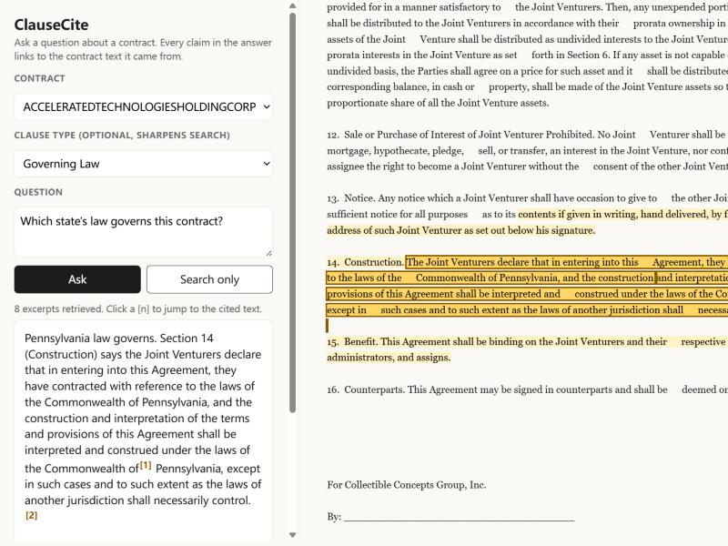

# ClauseCite

Ask a question about a commercial contract and get a short answer where every claim links to the exact contract language behind it.

Lawyers can't use an answer they can't verify, so each answer comes with citations. ClauseCite retrieves the relevant parts of the contract and has Claude answer only from them, using the Citations API. The citations are mapped back to character offsets in the full contract, and the UI highlights them. When the retrieved text doesn't cover the question, the model says so instead of guessing.



## Results

Evaluated on [CUAD](https://www.atticusprojectai.org/cuad): 510 real commercial contracts in which lawyers marked 41 types of clauses (governing law, termination for convenience, non-compete, and so on). The question is whether retrieval surfaces the clause a lawyer flagged. Each question gets the same budget of 4,000 characters, about an eighth of a typical contract.

On the official test split (102 contracts, 1,244 labeled clauses):

| Retrieval | Span recall | Hit rate | MRR |
|---|---:|---:|---:|
| BM25, CUAD's question as the query (baseline) | 44.4% | 51.4% | 0.382 |
| BM25 with expansion terms learned from labeled clauses, 500-char chunks | **72.3%** | **80.9%** | **0.599** |

- **Span recall** is the share of lawyer-marked spans that are at least half inside the retrieved text.
- **Hit rate** is the share of questions where at least one marked span was found.

All tuning was done on contracts outside the test set (see [eval/results.md](eval/results.md) for the full sweep). The test numbers were computed once, for the baseline and for the chosen config.

### What moved the number

The main problem is that users and contracts use different words. Someone asks "which law governs?" while the contract says "construed under the laws of the Commonwealth of Pennsylvania." Plain keyword search misses that.

For each clause type, `clausecite/expansion.py` finds the terms that are far more common inside lawyer-labeled clauses than in contracts overall (smoothed log-odds). Those terms are added to the query. A term must appear in at least 5% of a category's labeled clauses; without that floor, statute numbers like "1946" ranked first.

Other choices, each measured on dev:

- **Chunk size.** With a fixed character budget, 500-char chunks beat 1,000 and 2,000. Many small chunks cover more distinct places in the contract than a few large ones.
- **Query wording.** Removing CUAD's "Highlight the parts (if any)..." template boilerplate and adding the category name helped on its own (+6 points span recall), before any expansion.

The weakest categories are listed in [eval/results.md](eval/results.md). "Competitive Restriction Exception" (26%) is an exception that sits inside other clauses. "Document Name" (38%) is a title, not a clause, so there is little vocabulary to match.

## How it works

```
question ──► BM25 over 500-char chunks (offsets kept) ──► top 8 chunks ──► Claude + Citations API
              + learned expansion terms for the clause type                    │
                                                                               ▼
UI highlights the cited ranges ◄── citation offsets shifted to full-contract positions
```

| File | What it does |
|---|---|
| `clausecite/chunking.py` | Overlapping chunks that break at line or sentence boundaries and keep their offsets |
| `clausecite/bm25.py` | BM25 with corpus-wide IDF and postings grouped by contract, so single-contract search stays fast |
| `clausecite/expansion.py` | Learns per-category expansion terms from labeled clauses |
| `clausecite/answer.py` | Sends each chunk to Claude as a cited document and maps the citations back to contract offsets |
| `clausecite/evaluate.py` | Dev/test protocol, config sweep, per-category breakdown |
| `clausecite/server.py` | FastAPI: list contracts, search, ask |
| `static/index.html` | Single-page UI; click `[n]` to jump to the cited text |

BM25 is written from scratch rather than imported. The index is about 70 lines, and owning it made two things easy: weighted query terms and per-contract postings.

## Run it

Requires Python 3.11+.

```bash
python -m venv .venv
.venv/Scripts/activate            # macOS/Linux: source .venv/bin/activate
pip install -r requirements.txt
python scripts/fetch_cuad.py      # downloads CUAD (CC BY 4.0) into data/
python -m clausecite.expansion    # learns expansion terms from the non-test contracts
uvicorn clausecite.server:app     # http://localhost:8000
```

Search works without credentials. Answers need Claude API access, either `ANTHROPIC_API_KEY` or an `ant auth login` profile.

```bash
pytest                            # unit tests, no network
python -m clausecite.evaluate     # reproduces eval/results.md (~1 min)
```

## Next steps

- **Measure answer quality, not only retrieval.** Have a grader model check whether each cited quote supports the claim it is attached to, and whether "not covered" answers are correct.
- **Hybrid retrieval.** Add dense embeddings for paraphrases that the learned terms don't cover, and check whether they help the weakest categories.
- **Route free-form questions to a clause type automatically**, so users don't need to pick one to get expansion.
